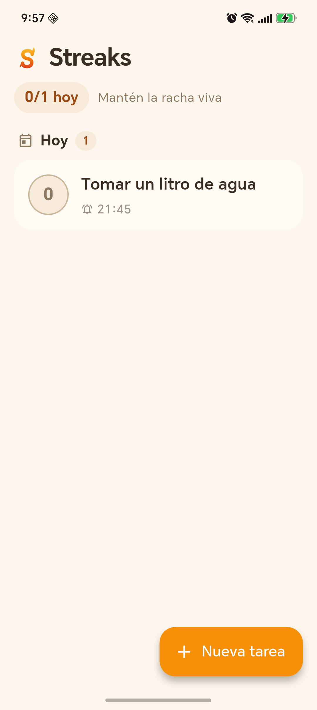
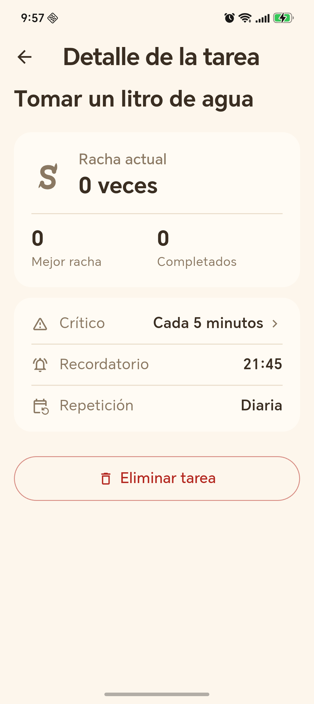

# Streaks

Rachas para rutinas que no puedes dejar caer.

Streaks es una app para Android que convierte una tarea repetitiva en un
hábito: te avisa a la hora que elegiste (y repite el aviso si la tarea es
importante), lleva la cuenta de los días que la completaste y te felicita
cuando la racha crece.

<p align="center">
  
  
</p>

## Qué hace

- **Tareas repetitivas con recordatorio obligatorio.** Cada tarea tiene una
  hora de aviso y no se puede crear sin ella.
- **Tres frecuencias.** Diaria, alterna (día por medio) o semanal. El
  calendario de cada tarea se ancla en el día en que la creaste.
- **Rachas que cuentan ciclos, no días.** Una tarea alterna cuenta su racha
  en ventanas de dos días y una semanal en semanas, no en días sueltos.
- **Niveles de insistencia.** Una tarea normal recibe un aviso, una
  importante se repite cada 15 minutos y una crítica cada 5 minutos, siempre
  dentro de una ventana de una hora.
- **Historial completo.** Cada completion se guarda como un registro, así
  que las rachas se calculan a partir de los datos y no de un contador.
- **El listado se ordena solo.** Las tareas de hoy arriba y las de los
  próximos días en su propia sección, con la fecha en la que vencen.

## Interacción

| Gesto | Qué hace |
|---|---|
| Deslizar a la derecha | Marca la tarea como completada (solo en las de hoy) |
| Deslizar a la izquierda | Abre la vista de detalle |
| Tocar la tarjeta | Abre la vista de detalle |

En la vista de detalle están la descripción, las rachas, el horario y el
cambio de nivel de importancia, además del botón de eliminar, que pide
confirmación.

## Requisitos

- Flutter 3.47 o superior (Dart 3.13).
- Verificado en un dispositivo con Android 16 (API 36).
- Un dispositivo o emulador Android con depuración por USB activada.
- Android SDK con las platform-tools en el `PATH`.

## Puesta en marcha

```bash
flutter pub get
dart run build_runner build --delete-conflicting-outputs   # genera database.g.dart
flutter run
```

`build_runner` es necesario porque el almacenamiento usa Drift: el código
de la base de datos se genera a partir de las tablas en `lib/data/`.
Después de tocar una tabla hay que volver a lanzarlo.

## Comprobaciones

```bash
flutter analyze          # debe salir limpio
flutter test             # la batería de tests
```

## Herramientas

### `tool/check_alarms.sh`

Una alarma programada puede estar en verde en todos los tests y aun así no
dispararse nunca. Este script es la forma de comprobar en el dispositivo
que los recordatorios están realmente registrados en el `AlarmManager` de
Android, y cuándo va a sonar cada uno.

```bash
bash tool/check_alarms.sh                    # la app de este repositorio
bash tool/check_alarms.sh com.otra.app       # cualquier otra app
bash tool/check_alarms.sh --help
```

El script no está atado a ninguna máquina: busca el binario de `adb` en el
`PATH`, en las rutas habituales del Android SDK y en las variables `ADB`,
`ANDROID_HOME` y `ANDROID_SDK_ROOT`. Con `ANDROID_SERIAL` se elige el
dispositivo cuando hay varios conectados.

```
==> Using <ruta al sdk>/platform-tools/adb
==> Device <serial del dispositivo>
==> Package com.amarrete.streaks

==> Pending alarms
    2026-11-17 21:45:00
    2026-11-17 21:50:00   (+5 min)
    2026-11-17 21:55:00   (+5 min)
    ...
    12 alarm(s)
    shortest gap: 5 min
```

### `tool/generate_icon.py` y `tool/install_android_icon.sh`

Generan los SVG del icono y los instalan como icono de lanzador en los
recursos de Android, en todas las densidades y en el formato adaptativo.
El logo de la app y el icono del lanzador comparten la misma geometría, así
que no pueden separarse.

```bash
python3 tool/generate_icon.py
bash tool/install_android_icon.sh
```

`generate_icon.py` solo usa la biblioteca estándar de Python. El script de
instalación rasteriza los SVG con `qlmanage` y `sips`, que son
herramientas de macOS: en Linux habría que sustituirlas por Inkscape o
ImageMagick.

## Cómo está hecho

| Pieza | Elección |
|---|---|
| Almacenamiento | SQLite con Drift (consultas tipadas) sobre el paquete `sqlite3` |
| Notificaciones | `flutter_local_notifications`, con alarmas inexactas |
| Zona horaria | `flutter_timezone` + `timezone` |
| Temas | Claro y oscuro, con la misma paleta cálida |

Las decisiones que conviene conocer antes de tocar el código:

- **El ancla de una tarea es su fecha de creación.** De ahí salen sus días
  de vencimiento y sus ciclos. Una tarea creada hoy con repetición alterna
  vence hoy, en dos días, en cuatro…
- **Las rachas se calculan en Dart**, sobre el calendario de cada tarea, no
  en SQL: el modelo de ciclos no se expresa bien en una consulta.
- **El recordatorio se programa solo en los días de vencimiento**, nunca en
  un día que la tarea no toca.
- **La ventana de cobertura de una hora** es deliberada: quien ignora doce
  avisos de una tarea crítica no va a atenderla, y cada alarma pendiente
  le cuesta batería al dispositivo.
- **La base de datos migra sola.** El esquema va por la versión 3 y cada
  cambio tiene su paso en `onUpgrade`, con un test que migra una base
  antigua de verdad.

## Estructura

```
lib/
  data/          tablas, DAO, calendario de las tareas, fechas
  notifications/ servicio de avisos y planificador de recordatorios
  screens/       lista de tareas y vista de detalle
  widgets/       tarjeta, selectores y encabezados de sección
  theme.dart     paleta y temas
tool/            scripts de apoyo
test/            tests de dominio, de base de datos y de widgets
docs/            capturas de pantalla
```

## Licencia

Public domain. Consulta [LICENSE](LICENSE).
